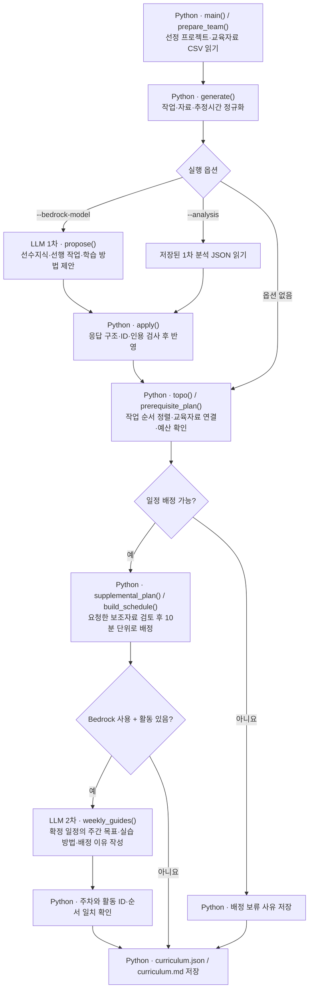

# 라운드랩 12주 커리큘럼 생성기

응용 프로젝트 하나와 교육자료 5~6개를 받아, 작업을 시작하기 전에 무엇을 어떤 순서로 공부할지 결정한다. 결과에는 주차별 학습·구현 활동, 시간, 목표, 산출물, 완료 확인 방법과 원문 근거가 담긴다. Python 3.10 이상에서 실행한다.

## 팀 자료로 실행

기본 실행은 다음 두 CSV만 읽는다. 함께 배포한 사본은 `data/aws_fde/`에 있다.

- `프로젝트_뽑힌프로젝트.csv` — 원본 Genkit과 보조 프로젝트 3개, 프로젝트별 차용 역량·관련 작업 번호
- `교육자료_고른자료.csv` — 핵심 2개와 보조 4개, 자료별 역량 연결 수준·URL·인용문

```sh
python3 curriculum_generator.py --hours-per-week 7 --output-dir result
```

원본 폴더는 `--team-folder "폴더 경로"`로 지정한다. 실행 한 번에 주당 가용시간 하나를 받아 12주 계획 하나를 출력한다. 두 CSV의 역량 ID, 인용문, 학습 구간과 자료가 부족한 역량은 [실행 결과 예시](team_results/curriculum.md)에서 확인할 수 있다.

Python은 원본 예제 실행·기능 구현·재현 검증과 보조 프로젝트별 확장 작업을 제안한다. P번호는 제안 작업 ID이며 W번호는 출처 참조다. 자료 유형과 실습 범위를 기준으로 시간을 추정한다. 확인한 원문 절은 절 이름을 사용한다. 미확인 구간은 CSV 인용문과 주제를 토대로 찾아볼 범위를 표시한다. 팀 초안은 `needs_review`(종료 코드 3)로 저장된다. `--strict`는 검토가 필요한 경우 일정을 보류한다.

## 보조자료를 보완학습으로 추가

기본 일정에서 선택되지 않은 보조자료도 `--include-reference 자료ID`로 요청할 수 있다. ID는 교육자료 CSV의 `id` 열에서 확인한다. 예를 들어 프롬프트 평가 노트북과 Go 자료를 모두 요청하려면 다음과 같이 실행한다.

```sh
python3 curriculum_generator.py --hours-per-week 7 \
  --include-reference E564ad08f67 \
  --include-reference E2a4fa23ce7 \
  --output-dir result
```

기본 작업과 선수학습을 배정한 뒤 남은 시간 안에서 요청 순서대로 추가한다. 관련 작업이 있으면 그 작업 완료 이후, 연결된 작업이 없으면 프로젝트 작업을 마친 뒤 배치한다. 이미 배정된 자료는 중복 배정하지 않는다. 시간 또는 선수지식이 부족하면 결과의 ‘요청한 보조자료’에 사유를 적는다. 여러 보조자료에 선수 관계가 있으면 선수 자료를 먼저 요청한다.

[주 7시간으로 보조자료 두 개를 포함한 실행 결과](team_results/with_supplemental_references/curriculum.md)와 [JSON 결과](team_results/with_supplemental_references/curriculum.json)를 확인할 수 있다.


## 가상 예제로 동작 확인

이 폴더에서 다음 명령을 실행한다. 기본 기간은 12주다.

```sh
python3 curriculum_generator.py --project examples/project_adapt.example.json --materials examples/materials.example.json --hours-per-week 7 --output-dir result
```

`result/curriculum.md`에서 주차별 안내를 읽을 수 있다. `result/curriculum.json`에는 작업별 선수지식과 배정한 자료 ID, 미충족 항목 및 검증 결과가 있다. 실행 예시는 `examples/output/`에도 들어 있다. 예제의 출처·시간·학습자 정보는 가상 데이터다.

기간은 `--weeks`, 주당 학습·구현 가용시간은 `--hours-per-week`로 지정한다. 주차와 개별 활동을 10분 단위로 배정하고, 가능하면 주차별 총시간 차이가 10분 이내가 되도록 분배한다. 활동 시간이 10분 배수가 아니면 위로 올리고, 가용시간 상한은 아래로 내린다.

## 입력 작성

| 위치 | 사용할 값 |
|---|---|
| 프로젝트 | `title`, `goal`, `packages[]`. 선택적으로 `learner.known`에 이미 아는 개념 ID를 적는다. `checks.passed`는 상위 프로젝트 검증 결과, `hours.budget`은 구현에만 적용하는 시간 한도다. |
| 각 작업 | `id, do, out, hours, core, competencies`는 작업·산출물·시간·핵심 여부·목표 역량이다. `requires`에는 시작 전에 알아야 하는 개념 ID만, `depends_on`에는 먼저 완료할 작업 ID만 넣는다. 선수조건이 없으면 빈 배열을 쓴다. `sources`에 출처/인용을, `completion_check`에 산출물 확인 방법을 넣는다. |
| 교육자료 | `core`와 `references` 배열 또는 역할을 지정한 단일 `materials` 배열. 각 자료의 `id, title, url, evidence`와 `hours` 또는 `minutes`를 제공한다. |
| 구간별 학습 | `sections[]`로 나눌 수 있다. `teaches`는 실제 가르치는 개념, `requires`는 자료 자체의 선수지식, `study_method`는 실습 방법이다. `teaches` 생략 시 기존 `competencies`를 사용한다. 구간별 시간은 개별 지정하며, 자료 전체의 선수조건은 구간에도 적용한다. |
| 설명만 있을 때 | 자료·작업의 `description`, `summary`, `prerequisite_text`에 설명을 넣고 선택적 Bedrock 분석을 쓸 수 있다. URL은 출처로 보존하며 원문은 입력에 담긴 텍스트만 사용한다. |

작업과 자료는 동일한 개념을 동일 ID로 표현한다. 작업의 `requires`를 생략하고 분석도 요청하지 않으면 목표 역량을 임시 선수지식으로 사용하고 검토 필요로 표시한다. 선수정보가 모두 없는 기존 형식은 기존 역량 기반 선택 경로로 처리한다.

## 계획의 결정과 검증

1. 핵심 작업과 그 선행 작업을 모으고, 작업 의존 순서로 정렬한다.
2. 작업에 필요한 개념에서 출발해 가르치는 자료를 찾고, 해당 자료의 선수 개념도 따라간다. 이미 아는 개념이나 앞에서 배정한 개념은 학습 시간을 다시 더하지 않는다.
3. 제공 가능한 경로 중 핵심 자료를 우선하고, 같은 역할 안에서는 해당 개념의 선수학습까지 포함한 시간이 짧은 경로를 고른다. 핵심 우선 경로가 예산을 넘기면 같은 선수조건을 만족하는 대체 경로를 탐색한다. 자료 누락·시간 미정·순환으로 핵심 경로를 구성할 수 없으면 작업 ID와 이유를 출력한다.
4. 핵심 학습·구현 시간을 먼저 확보한다. 확장 작업은 선행 작업과 학습시간까지 예산에 들어올 때 추가한다. 한 주 상한을 넘는 활동은 다음 주에 이어서 배정한다.
5. 12주 계획에서 학습 권장 비중 60%(1~3주), 40%(4~8주), 25%(9~12주)를 실제 배정 비중과 함께 기록한다. 권장 비율은 목표 비교용이다. 학습 방법이나 완료 기준이 빠지면 안내 문구를 사용하며, 작업 출처·완료 기준 등 검토할 항목은 경고에 남긴다.

`ready`는 입력에 근거해 일정을 배정했다는 뜻이다. `needs_review`는 계획과 확인 항목을 함께 제공한다. `blocked`는 필수 경로나 시간 예산 문제 등으로 주차 배정을 보류했다는 뜻이다. `--strict`를 주면 검토가 필요한 제안·근거도 보류한다. 반환 코드는 ready 0, 검토/보류 3, 입력/분석 오류 2다. 실제 학습 효과와 시간은 실측 대상이다.

## 선택 사항 · Bedrock으로 설명 분석

AWS CLI v2와 Bedrock Converse 도구 호출을 지원하는 모델, 해당 모델 사용 권한이 필요하다. 위 실행 명령에 `--bedrock-model 모델ID --profile 프로필명 --region 리전명`을 붙인다. 명시적으로 이 옵션을 사용할 때 작업·자료 텍스트를 AWS에 전송한다.

### Python과 LLM 실행 순서



| 옵션 | AWS 호출 | 적용 방식 |
|---|---:|---|
| 옵션 없음 | 0회 | 로컬 규칙으로 학습과 작업을 배정하고 안내를 작성한다. |
| `--analysis 제안.json` | 0회 | `curriculum.json`의 `analysis_proposal`을 별도 JSON으로 저장해 재사용한다. 주차별 안내는 로컬에서 작성한다. |
| `--bedrock-model 모델ID` | 1~2회 | 첫 호출은 선수학습 분석을 제안한다. 활동이 배정되면 두 번째 호출로 주차별 안내를 작성한다. |

- **1차 호출은 배정에 영향을 줄 수 있다.** 팀 CSV 경로에서는 LLM의 선수지식·학습 방법을 적용하고, 제안한 선행 작업을 기존 관계에 추가한다. 자료의 제공 역량은 CSV 값을 유지한다. JSON 입력에서는 명시된 값을 우선한다. 입력에서 인용을 확인하지 못한 팀 CSV 제안은 `LLM 생성 제안 · 원문 미확인`으로 표시하고, 인용 일치 여부는 `analysis_provenance`에 남긴다. 개별 학습·구현 시간은 입력값 또는 CSV 변환 단계의 추정값을 사용한다. [1차 분석 적용 코드](lesson_analysis.py#L61-L115) · [배정 코드](curriculum_generator.py#L628-L779)
- **2차 호출은 확정된 일정에 안내를 붙인다.** Python은 응답의 주차와 활동 ID 순서가 일정과 일치하는지 확인하고 목표·방법·이유만 저장한다. 두 호출 모두 `invoke()`에서 Python의 `subprocess.run()`으로 `aws bedrock-runtime converse`를 실행하고 구조화된 JSON 응답을 읽는다. [주차별 안내 코드](lesson_analysis.py#L118-L135) · [AWS 호출 코드](lesson_analysis.py#L33-L58)

테스트 실행 · `python3 -m unittest discover -s tests -v`
